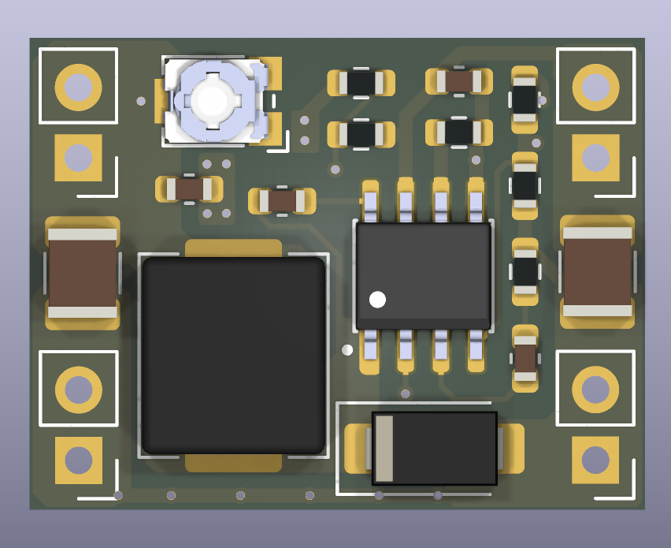
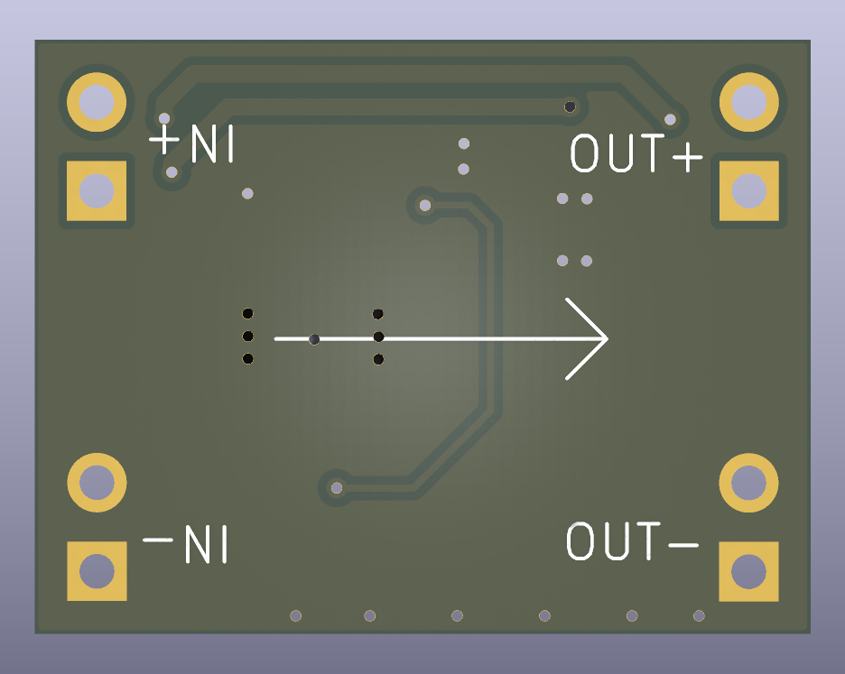
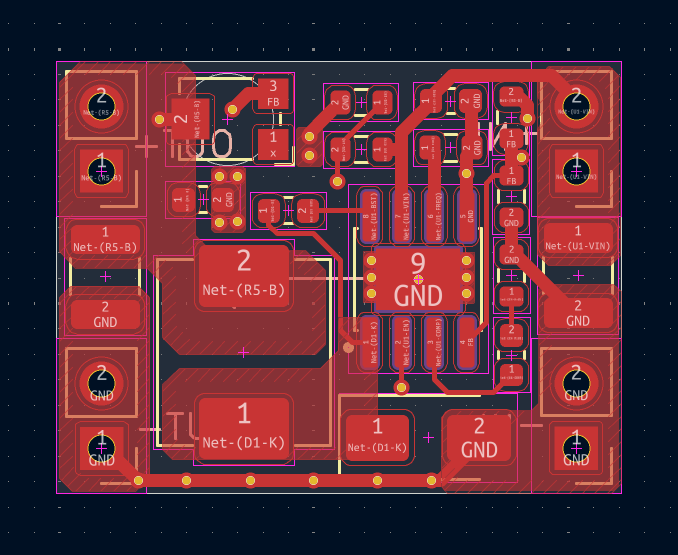
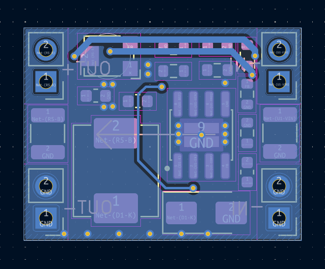
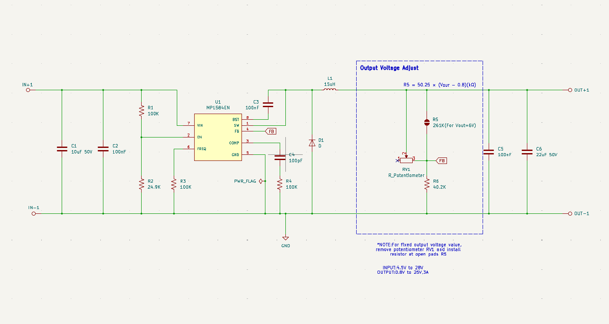

# MP1584EN Adjustable Buck Converter

An adjustable DC-DC step-down converter PCB based on the MP1584EN switching regulator. The design includes input and output terminals, an adjustable output-voltage control, and a compact layout.

<p align="center">
  
</p>

## Design specifications

The schematic lists the following design targets:

| Parameter | Design target |
| --- | --- |
| Regulator | MP1584EN |
| Input voltage | 4.5 V to 28 V |
| Adjustable output voltage | 0.8 V to 25 V |
| Output current | Up to 3 A, subject to input/output conditions and thermal limits |
| Output adjustment | RV1 potentiometer |

These are schematic specifications, not verified performance measurements. Check the regulator datasheet and validate the assembled board under your intended load before use.

## Board views

### Front


### Back



### Copper footprint views

| Front copper | Back copper |
| --- | --- |
|  |  |

The board is marked with input (`IN+`, `IN-`) and output (`OUT+`, `OUT-`) connections.

## Schematic



The output can be made fixed by removing potentiometer RV1 and installing a resistor at R5. The schematic gives the relationship:

```text
R5 (kΩ) = 50.25 × (VOUT - 0.8)
```

Confirm the resulting voltage and resistor value against the schematic and regulator datasheet before powering the board.

## Project files

| Path | Description |
| --- | --- |
| `MP1584_module_pcb/MP1584EN_buck_module.kicad_sch` | Editable circuit schematic |
| `MP1584_module_pcb/MP1584EN_buck_module.kicad_pcb` | Editable PCB layout |
| `MP1584_module_pcb/MP1584EN_buck_module.kicad_pro` | KiCad project settings |
| `MP1584_module_pcb/Gerber_file/` | Gerber fabrication layers |
| `media/image/` | Board renders, schematic image, and footprint views |

Open the KiCad project in a compatible KiCad version to inspect or edit the design. Review the schematic, board layout, footprints, clearances, and design-rule-check results before fabrication. The included Gerber files should also be checked against the final PCB layout.

## Safety and use

This design can involve potentially high currents. Use a suitable current-limited power source, verify input polarity and output voltage before connecting a load, and account for regulator and component heating. No assembled-board testing is documented here.